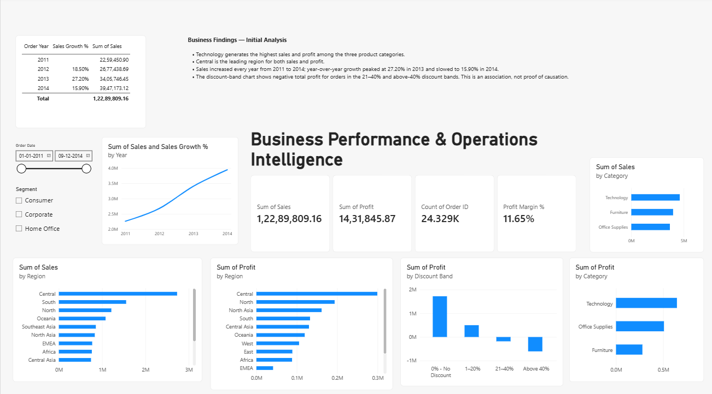

# Business Performance & Operations Intelligence

An interactive business analytics project combining Power BI dashboards with a Python-based AI assistant to turn sales metrics into management insights.

## Project Overview

This project analyzes the Global Superstore dataset to explore sales performance, profitability, regional results, category performance, and discount patterns.

It combines Power BI for business intelligence with Streamlit and Google Gemini for AI-assisted management reporting.

## Key Features

- KPI tracking for total sales, total profit, and profit margin
- Sales and profit analysis by category and region
- Year-over-year sales growth analysis
- Discount-band profitability exploration
- Interactive Power BI filters for segment and order date
- AI-generated management summaries and recommendations
- Explicit limitations to help prevent unsupported conclusions

## Technology Stack

- Power BI Desktop — dashboards and DAX measures
- Python — application logic
- Streamlit — interactive web application
- Google Gemini API — AI-generated business insights
- Pandas — data analysis ecosystem
- JSON — local business metrics
- Git and GitHub — version control and project hosting

## Business Metrics

The current dataset analysis includes:

- Total sales
- Total profit
- Profit margin
- Year-over-year sales growth
- Profitability patterns across discount bands

The yearly sales growth results currently recorded are:

| Year | Sales Growth |
|---|---:|
| 2012 | 18.50% |
| 2013 | 27.20% |
| 2014 | 15.90% |

## Project Structure

```text
BusinessInsightsAI/
├── app.py
├── business_metrics.json
├── requirements.txt
├── README.md
└── .gitignore
```

The `.env` file stores the Gemini API key locally and must not be committed to GitHub.

## Run Locally

### 1. Clone the repository

```bash
git clone YOUR_REPOSITORY_URL
cd BusinessInsightsAI
```

### 2. Create and activate a virtual environment

Windows:

```powershell
python -m venv .venv
.venv\Scripts\activate
```

### 3. Install dependencies

```powershell
python -m pip install -r requirements.txt
```

### 4. Configure the Gemini API key

Create a `.env` file in the project folder:

```text
GEMINI_API_KEY=your_api_key_here
```

Replace the placeholder with your own API key. Never publish this file.

### 5. Start the application

```powershell
streamlit run app.py
```

Open the local URL displayed in the terminal.

## Important Limitations

- The Streamlit application reads metrics from `business_metrics.json`; it does not automatically synchronize with Power BI.
- AI-generated recommendations require human review and validation.
- A relationship between discount levels and negative profit does not establish causation.
- The project uses historical dataset metrics and should not be treated as a live business reporting system.

## Future Improvements

- Automate data preparation and metric validation
- Connect the application to a refreshable data source
- Add deeper product and regional profitability analysis
- Include automated data-quality checks


## Screenshots

### Power BI Dashboard



### AI Business Insights Assistant

.png)

.png)

- Improve AI report evaluation and reproducibility

## Disclaimer

This is an exploratory business analytics project intended for learning and portfolio demonstration. Business decisions should be based on validated data and appropriate financial analysis.
